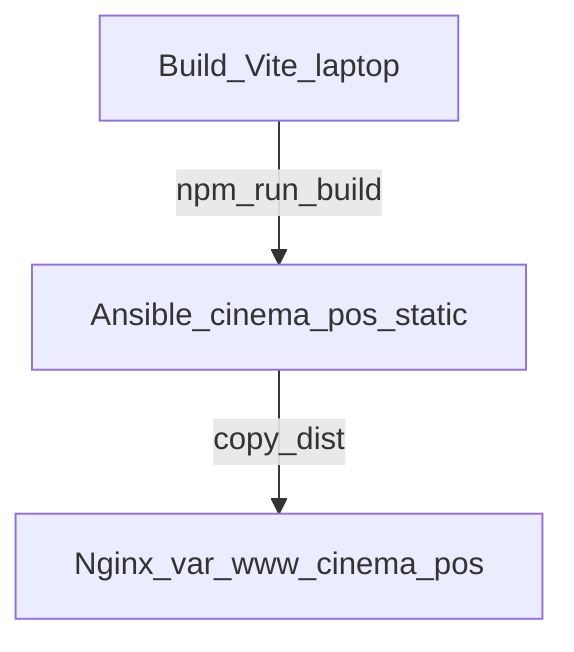

# Arsitektur — Ansible Deep Dive Cinema Outlets (On-Prem)

## Control node vs managed nodes

- **Control node:** laptop (Ansible CLI + build Vite).
- **Managed nodes:** server outlet **on-prem** — lab = container Docker + SSH; produksi = server/VM di LAN atau VPN cabang.

Autentikasi: **SSH public key** (user `ansible`).

Deep Dive ini **bukan** use case cloud VM sebagai target inventory.

## Alur deploy POS

1. Role `cinema_pos_static` (atau script `package-release.sh`) membangun `apps/cinema-pos/dist/` di control node.
2. Ansible `copy` isi `dist/` ke `/var/www/cinema-pos` di tiap outlet.
3. Template `config.json` + generate `config.enc` di `/opt/cinema-pos/`.
4. Update UI berikutnya: build ulang → re-run playbook (`--tags pos`).

Tidak ada unduhan artifact dari GitHub.

## Roles

`commons` → `postgres` → `postgres_import` → `nginx` → `cinema_pos_static`.
