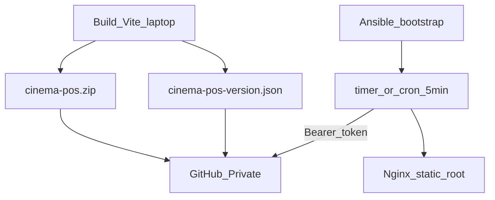

# Arsitektur — Ansible Deep Dive Cinema Outlets (On-Prem)

## Control node vs managed nodes

- **Control node:** laptop (Ansible CLI + build Vite / package ZIP).
- **Managed nodes:** server outlet **on-prem** — lab = container Docker + SSH; produksi = server/VM di LAN atau VPN cabang.

Autentikasi: **SSH public key** (user `ansible`).

Deep Dive ini **bukan** use case cloud VM sebagai target inventory.

## Alur artifact POS

1. `./apps/cinema-pos/scripts/package-release.sh` → ZIP + bump version JSON → upload GitHub private.
2. `setup-lab-ssh.sh` → key lab + 3 container.
3. `playbooks/tutorial/site.yml` (`serial: 1`) bootstrap roles termasuk `cinema_pos_static`.
4. Role memasang updater (systemd timer **atau** cron `*/5` di lab Docker); first pull mengisi `/var/www/cinema-pos` dari ZIP.
5. Poll: bandingkan version lokal vs GitHub → download jika lebih baru → symlink release → preserve `assets/` lama → reload Nginx.

Secrets (`config.enc`) dan script updater tinggal di `/opt/cinema-pos/` (di luar document root).

## Roles

`commons` → `postgres` → `postgres_import` → `nginx` → `cinema_pos_static`.
